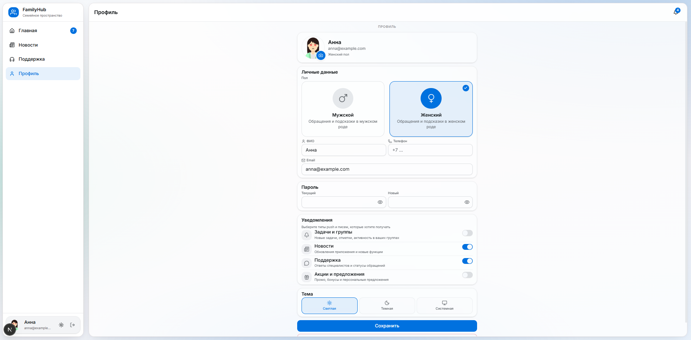
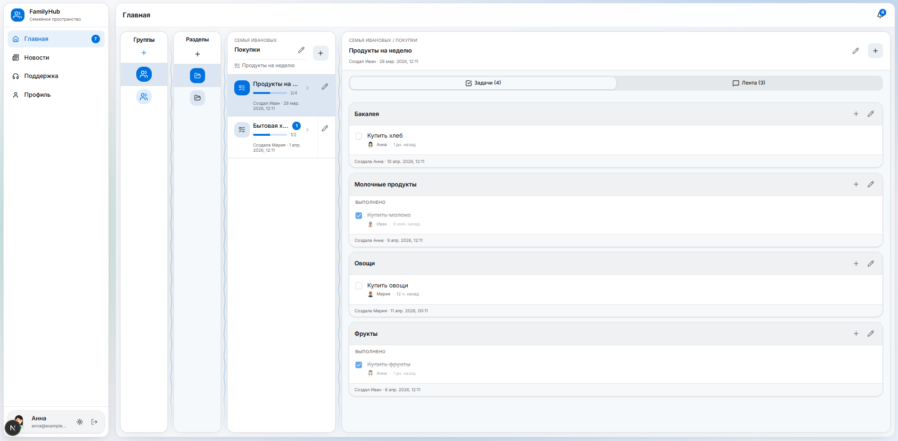
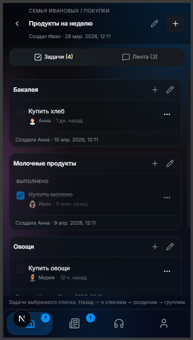
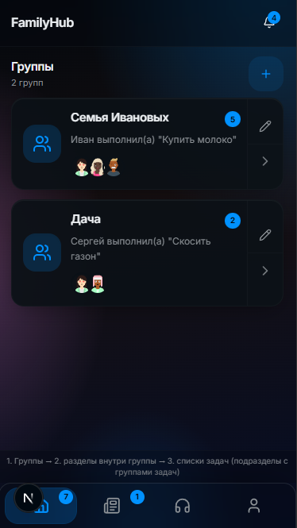
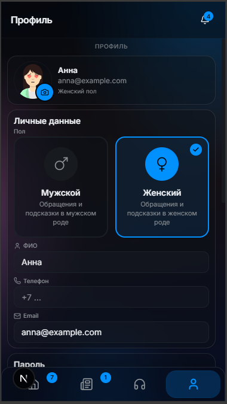
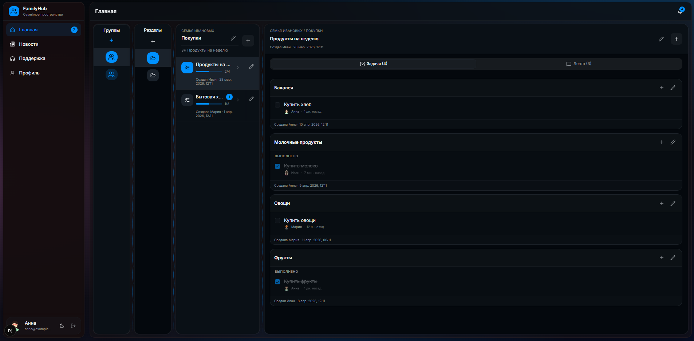

# FamilyHub

**Семейное пространство** — веб-приложение для совместных списков дел, покупок и организации жизни семьи в одном интерфейсе. Удобная иерархия «группы → разделы → списки → задачи», лента активности, новости, поддержка и профиль с темой оформления.

---

## Скриншоты

### Группы на мобильном

Стартовый уровень: карточки семей и сообществ с бейджами активности, последними событиями («кто что сделал») и аватарами участников. Отсюда начинается путь: группы → разделы → списки задач.



### Главная: группы, разделы и списки (десктоп, светлая тема)

Колоночная навигация: **группы**, **разделы** внутри группы, **списки** с прогрессом и широкая панель списка с вкладками «Задачи» и «Лента». Пункты сгруппированы по категориям; видны автор и время.



### Список задач на телефоне (тёмная тема)

Компактный вид выбранного списка: категории, выполненные пункты, подсказка навигации назад по уровням. Нижняя панель — главная, новости, поддержка, профиль.



### Профиль и данные аккаунта (десктоп)

Личные данные, смена пароля, уведомления и выбор темы (**светлая** / **тёмная** / **системная**) — на карточках с единым стилем FamilyHub.



### Профиль на телефоне

Тот же профиль в мобильной вёрстке: аватар, контакты, выбор пола для корректных обращений в интерфейсе.



### Главная в тёмной теме (десктоп)

Та же колоночная схема в тёмном оформлении: комфорт вечером и визуальная связка с мобильной тёмной темой.



---

## Возможности

- **Иерархия** — группы, разделы, списки задач с прогрессом и категориями внутри списка.
- **Совместная работа** — автор и время у задач, лента событий по списку.
- **Адаптив** — десктоп с несколькими колонками и пошаговая навигация на телефоне.
- **Темы** — светлая, тёмная и системная.
- **Разделы** — главная, новости, поддержка (чат и база знаний), профиль и уведомления.

## Стек

Next.js, React, TypeScript, Tailwind CSS, Radix UI, Zustand (контекст/store), Vercel Analytics.

## Запуск

```bash
npm install
npm run dev
```

Откройте [http://localhost:3000](http://localhost:3000).

## Деплой

Сборка для продакшена использует режим [**standalone**](https://nextjs.org/docs/app/api-reference/config/next-config-js/output) (`output: 'standalone'` в `next.config.mjs`): в образ или на сервер попадают только нужные артефакты и `server.js`, без полного `node_modules`.

### Локальная продакшен-сборка

```bash
npm install
npm run build
npm run start
```

Сервер слушает порт **3000** (задаётся переменной окружения `PORT`).

### Docker

Нужны установленные [Docker](https://docs.docker.com/get-docker/) и Docker Compose. В корне репозитория лежат [`Dockerfile`](Dockerfile) и [`docker-compose.yml`](docker-compose.yml); контекст сборки задаёт [`.dockerignore`](.dockerignore).

**Через Compose** (сборка образа и запуск контейнера `family-chat-web`):

```bash
docker compose up --build
```

Приложение: [http://localhost:3000](http://localhost:3000). Остановка: `Ctrl+C` или `docker compose down`. Фоновый режим: `docker compose up -d --build`, остановка: `docker compose down`.

Первая сборка образа может занять несколько минут (`npm ci` + `next build`).

**Только Docker** (сборка и запуск вручную):

```bash
docker build -t family-chat .
docker run --rm -p 3000:3000 family-chat
```

Образ многостадийный: зависимости → `next build` → финальный слой на Node 22 Alpine с непривилегированным пользователем `nextjs`.

### Переменные окружения

Сейчас приложению не требуются обязательные секреты для сборки. Если позже появятся `NEXT_PUBLIC_*` или серверные переменные, задайте их в Compose (`environment` / файл `.env` рядом с `docker-compose.yml`) или при `docker run -e …`, а для хостинга — в панели провайдера.

### Другие платформы

Проект — обычное Next.js-приложение: его можно выкладывать на **Vercel**, **Node-хостинг** или **Kubernetes**, подставив ту же команду запуска `node server.js` (из каталога standalone) или стандартный `npm run start` после `npm run build` на машине со всеми зависимостями.

---

*FamilyHub — место, где семья видит общие дела и не теряет детали.*
