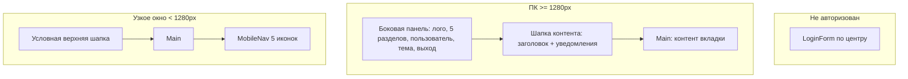

# Структура пользовательского интерфейса FamilyHub

Документ описывает экраны, навигацию, **визуальный язык**, композицию интерфейса в **версии для ПК** и **в узком окне («мобильная» компоновка)**, а также **пользовательские пути**. Источник правды — `AppShell`, `globals.css` и дочерние компоненты в `components/`.

---

## Содержание

1. [Критерий ПК / мобильная](#как-приложение-выбирает-пк-или-мобильную-версию)
2. [Визуальный язык и дизайн-система](#визуальный-язык-и-дизайн-система)
3. [Общие элементы](#общие-элементы-и-там-и-там)
4. [ПК (≥ 1280px)](#версия-для-пк-ширина--1280px)
5. [Узкое окно (&lt; 1280px)](#мобильная-версия-ширина--1280px)
6. [Разделы подробно](#разделы-подробно-по-ui)
7. [Пользовательские пути](#пользовательские-пути)
8. [Маршруты Next.js](#маршрутизация-nextjs-связь-с-ui)
9. [Схема и файлы](#краткая-схема-иерархии)

---

## Как приложение выбирает «ПК» или «мобильную» версию

- Переключение зависит от **ширины окна**, не от user-agent.
- `useIsMobile()` в `components/ui/use-mobile.tsx`: медиазапрос **`max-width: 1279px`**.
  - **&lt; 1280px** — одноколоночная оболочка + **`MobileNav`** снизу.
  - **≥ 1280px** — боковая панель + стеклянная основная колонка.
- Внутри **десктопной** ветки для **«Главной»** дополнительно используется **гистерезис по ширине** (`useViewportWidthHysteresis(1279, 1536)` в `app-shell.tsx`): колонки сужаются и переходят в режим «иконки» при уменьшении окна и разворачиваются обратно только при большей ширине — чтобы интерфейс не «дёргался» на границе.
- Breakpoint’ы Tailwind (`lg:`, `xl:` и т.д.) в дочерних списках работают **поверх** выбранной ветки: на мобильной вёрстке приложения часто срабатывают правила `max-lg:` (оформление карточек групп и т.п.).

---

## Визуальный язык и дизайн-система

### Токены и тема

- Цвета и радиусы заданы в `app/globals.css` через **CSS-переменные** (`--background`, `--primary`, `--card`, `--border`, `--radius` ≈ `0.75rem` и производные `radius-sm` … `radius-xl`).
- Поддерживаются **светлая** и **тёмная** схемы (класс `.dark` на контейнере темы).
- Смена темы может сопровождаться **View Transitions API** (плавный кроссфейд корня), с уважением к `prefers-reduced-motion`.

### Фон приложения

- Утилита **`.app-shell-bg`**: базовый фон + несколько **радиальных градиентов** (акцент `primary`, вторичный оттенок из палитры графиков) и **диагональный линейный градиент**; `background-attachment: fixed` для ощущения глубины при прокрутке.
- Экран входа дополнительно использует **размытые круги** поверх фона в разметке `AppShell`.

### «Хром» панелей (десктоп)

- **`.app-chrome-panel`** — непрозрачная «карта» сайдбара: скругление `radius-xl`, тонкая рамка, многослойная тень и **внутренняя подсветка** (`inset` highlight) в светлой теме; в тёмной — более глубокие тени и приглушённая рамка.
- **`.app-chrome-panel-glass`** — основная колонка: полупрозрачный фон карточки, **`backdrop-filter: blur(16px)`**, своя тень и рамка. Создаёт эффект стекла поверх градиентного фона.

### Типографика

- Шрифт: **Inter** (подмножества latin + cyrillic), переменная `--font-inter`, в `body` — `font-sans antialiased`.
- В узкой мобильной оболочке класс **`.mobile-ui-compact`** (включается на корне при `isMobile`) при **`max-width: 767px`** уменьшает базовый **`font-size` до `0.8125rem`** и задаёт плотный `line-height` для единообразной «мобильной» плотности текста.

### Скроллбары и интерактив

- Кастомный **тонкий скроллбар** (6px, «бегунок» из `muted`).
- Нативные кнопки (не из shadcn) получают **лёгкий scale при нажатии** (`active: scale(0.97)`) и `touch-action: manipulation`.

### Колонки «Главной» на десктопе (lg+)

- Панели списков используют классы **`homePaneClass` / `homePaneMutedClass`** в `app-shell.tsx`: на больших экранах это **скруглённые карточки** с рамкой, тенью и лёгким **внутренним бликом**; в тёмной теме — усиленные тени и приглушённые границы.
- Между колонками — декоративный **`DesktopHomeColumnDivider`**: узкая вертикальная полоса с **волнистым SVG-паттерном** и градиентной маской (визуально «рельса», не сплошная линия).

---

## Общие элементы (и там, и там)

### Неавторизованный пользователь

- Полноэкранный **`app-shell-bg`** + декоративные пятна.
- По центру — **`LoginForm`** в **`Card`**: иконка Users в квадрате `primary`, заголовок FamilyHub, описание, поля Email/пароль с иконками слева, **переключение видимости пароля**, состояние загрузки (**`Spinner`**), ошибка валидации, кнопка входа, ссылки на регистрацию и «Забыли пароль».

### Пять разделов приложения

| Раздел | Подпись в UI | Назначение |
|--------|----------------|------------|
| `home` | Главная | Иерархия группа → раздел → список → задачи |
| `news` | Новости | Лента и карточка статьи |
| `chat` | Чат | Список тредов и переписка |
| `support` | Поддержка / Техподдержка | Чат с ботом и база знаний |
| `profile` | Профиль | Данные, уведомления, тема, выход |

Иконки в навигации: **Home, Newspaper, MessageCircle, Headphones, User** (lucide-react).

### Уведомления (`NotificationsBell`)

- Триггер: **ghost**-кнопка `h-9 w-9`, иконка колокола; при непрочитанных — **круглый бейдж** (до `99+`).
- **Popover** справа (`align="end"`), ширина `min(100vw - 2rem, 22rem)`, без внутренних отступов у корня (`p-0`).
- Шапка поповера: заголовок «Уведомления», кнопка **«Прочитать все»** (если есть непрочитанные).
- Список в **`ScrollArea`** высотой `min(24rem, 50vh)`: строки-кнопки с разделителями; непрочитанные с **точкой-primary** и лёгким фоном `primary/5`; текст — заголовок, тело (`line-clamp-2`), время «относительно сейчас».
- По клику: пометка прочитанным, выставление контекста в store (группа/раздел/список, id новости, вкладка поддержки, peer чата), вызов **`onInboxNavigate`** для переключения вкладки оболочки.

### Тема оформления

- **Десктоп:** внизу сайдбара **`ThemeToggle`** — кнопка с анимированной сменой Sun/Moon, **dropdown** с пунктами Светлая / Тёмная / Системная.
- **Профиль:** дублирующий выбор темы — **сетка из трёх кнопок** с иконкой и подписью, активная обведена `primary`.

### Диалоги выхода

- На десктопе выход из сайдбара открывает **`AlertDialog`** (подтверждение, деструктивное действие «Выйти»).
- В профиле — отдельный такой же диалог для кнопки «Выйти» внизу страницы.

---

## Версия для ПК (ширина ≥ 1280px)

### Внешний каркас

- Горизонтальный flex на **`h-dvh`**, **`gap-3` / `md:gap-4`**, паддинги **`p-3` / `md:p-4`**, без вертикальной прокрутки всего окна — только внутри панелей.

### Левая боковая панель (`aside`)

- Ширина **`w-[13.5rem]`**, на **`2xl`** — **`w-[15.5rem]`**, класс **`app-chrome-panel`**.
- **Верх (h-14):** квадратная иконка FamilyHub (`primary`), название «FamilyHub», подзаголовок «Семейное пространство» (скрывается при **`max-xl`** на этом блоке — актуально при экстремально узкой зоне контента рядом, редко).
- **Навигация:** скроллируемая область с вертикальным стеком **`Button`**: `ghost` / `secondary`, активный с **`bg-primary/10 text-primary`**. У каждого пункта иконка 16px, подпись, **бейдж справа** (`ml-auto`, капсула `primary`) при счётчике > 0.
  - Счётчики: **Главная** — сумма `unreadCount` по группам; **Новости / Поддержка / Профиль** — непрочитанные inbox по `target.kind`; **Чат** — сумма `unreadCount` по тредам.
- **Низ:** разделитель, карточка пользователя в **`rounded-xl`**, `border`, `bg-muted/45`: аватар, имя, email (truncate), **`ThemeToggle`**, кнопка выхода (ghost icon, hover destructive).

### Правая колонка (`app-chrome-panel-glass`)

- **Header (`h-14`):** заголовок второго уровня — текст зависит от `desktopTab` («Главная», «Новости», «Чат», «Техподдержка», «Профиль»); справа **`NotificationsBell`**.
- При **`homeViewportNarrowHysteresis`** под шапкой на **Главной** показывается **полоска-подсказка** (роль `note`): про наведение на иконки для полных названий в узких колонках.
- **`main`:** flex-колонка **`min-h-0 flex-1 overflow-hidden`** — контент вкладки.

### Вкладка «Главная» на ПК

Область с **`lg:bg-muted/25`** и внутренними отступами, далее ряд колонок:

1. **Группы** — `aside` c `GroupsList`, скрыт **`hidden lg:block`** на маленьких внутренних ширинах не применяется к shell (десктоп уже ≥1280), колонка всегда показывается на lg+.
   - Ширина: либо вычисленная в px (хук **`useGroupsColumnWidthPx`**), либо классы `w-52` / `2xl:w-60`, либо **компактные** пресеты (`compactGroupsColumn`, `groupsColumnCompact`, `groupsListIconOnlyColumnClass`).
2. **Разделы** — `SectionsList`; если группа не выбрана, колонка **`hidden`**, кроме **`lg:block`** — показывается пустая зона с empty state внутри компонента.
3. **Списки задач** — при **`selectedSectionId`**: третья колонка **`hidden xl:block`** (отдельная колонка только от **`xl`** Tailwind, 1280px viewport width — совпадает с порогом shell). Разделители перестраиваются (`flex xl:hidden` / `hidden xl:flex`).
4. **Деталь списка** — **`TaskListDetail`** в **`flex-1 min-w-0`** с `homePaneMutedClass`.

Режимы **icon-only** для строк списков на десктопе связаны с флагами **`desktopIconOnlyRows`** и анимацией раскрытия колонки (**`useColumnRevealAfterExpand`**) — кратковременно узкая колонка может показывать только иконки до завершения анимации.

### Вкладка «Чат» на ПК

- Flex-строка на всю высоту.
- Слева: **`ChatThreadList`** в контейнере **`max-w-sm lg:max-w-[22rem]`**, фон **`bg-card/40`**, на **`lg`** правая граница.
- Справа: **`border-l`**, либо **`ChatConversation`**, либо **`Empty`** «Выберите чат» с иконкой и пояснением про поиск.

### Прочие вкладки на ПК

- **Новости, Поддержка, Профиль** — те же компоненты, что в узком режиме; занимают **`main`** под общей шапкой оболочки.

---

## «Мобильная» версия (ширина &lt; 1280px)

### Каркас

- Колонка **`h-dvh max-h-dvh`**, **`overflow-hidden`**, классы **`app-shell-bg mobile-ui-compact`**.
- Структура: **опциональный верхний бар** → **`main flex-1`** → **`MobileNav`**.

### Верхний бар

- Условие **`showMobileShellHeader`:** скрыт на **Главной** (кроме случаев, когда показывается свой заголовок внутри шага — см. ниже) для первого шага не используется глобальный заголовок вкладки; для **Чата** скрыт, если открыт диалог (**`selectedChatPeerId`**), чтобы не дублировать шапку с «Назад».
- Когда виден: **`border-b`**, **`bg-background/45 backdrop-blur-md`**, заголовок слева (**название вкладки** из `shellNavItems`), справа **`NotificationsBell`**.

### Главная — многошаговый поток

- **`homeView`:** `groups` → `sections` → `taskLists` → `taskDetail`.
- **Шаг `groups`:** локальная шапка **«FamilyHub»** + колокол; ниже **`GroupsList`**.
- Остальные шаги используют **встроенные** кнопки «Назад» в **`SectionsList` / `TaskListsList` / `TaskListDetail`** (chevron), без дублирования заголовка вкладки «Главная» в глобальном баре.

### `MobileNav`

- **`nav`** с **`rounded-t-2xl`**, верхняя и боковые границы, **`backdrop-blur-xl`**, полупрозрачный фон, тень вверх.
- Нижний паддинг с **`max(..., env(safe-area-inset-bottom))`**.
- Пять **`button`**: flex-колонка, иконка ~`1.2rem`, **пустая строка подписи** в разметке (визуально упор на иконки); активный пункт — **`text-primary`**, иконка с большей толщиной штриха.
- Фоновая **«пилюля»** под активной вкладкой: `absolute`, ширина `100/5 %`, `translateX` по индексу, плавная анимация `transform/width`.
- Бейджи: **`absolute right-1 top-1`**, капсула для чисел > 99 → `99+`.
- **`aria-label="Основная навигация"`**, у активной кнопки **`aria-current="page"`**.

### Чат

- Без выбранного peer — полноэкранный **список** (поиск + скролл).
- С peer — **`ChatConversation`** с **`onBack`**, глобальная шапка оболочки отключена.

---

## Разделы подробно (по UI)

### Главная — группы (`GroupsList`, `GroupCard`)

- **Шапка списка:** заголовок «Группы», на десктопе в полном режиме — число групп и подсказка **«Дальше: раздел → список → задачи»** только на **`lg:hidden`** (т.е. в мобильной вёрстке приложения). Кнопка **«+»** создаёт группу (диалог).
- **Пустое состояние:** на мобильной ширине — **пунктирная карточка**; иконка Users.
- **`GroupCard`:**
  - **До `lg` (мобильное приложение):** отдельная **карточка** с сильным скруглением, рамкой, тенью; выбранная — градиент/primary акцент; нажатие слегка **`scale-[0.99]`**.
  - **От `lg` (десктоп):** строка списка с hover **`bg-accent/50`**, выбранная **`bg-accent`**.
  - Содержимое: иконка Users в цветном квадрате, название, **стрелка**, **бейдж непрочитанного** (в т.ч. мини-бейдж в режиме `desktopIconOnly`), строка последней активности, кнопка карандаша (редактирование).

### Главная — разделы (`SectionsList`)

- Шапка: на мобилке **«Назад»** слева; название **группы** с кнопкой переименования; счётчик секций; **«+»** создание раздела. В режиме **`desktopIconOnlyRows`** заголовок «Разделы» может центрироваться в колонке.
- **Empty** без группы: «Выберите группу».

### Главная — списки (`TaskListsList`)

- Аналогичная шапка с контекстом **секции**, назад, создание списка (**диалог названия**), редактирование секции.
- Карточки списков (`TaskListCard`), выделение выбранного, **rename** через диалог.

### Главная — деталь списка (`TaskListDetail`)

- **Шапка:** опционально **«Назад»** (мобильный поток); мелкий uppercase **«группа / раздел»**; название списка + карандаш (управление задачами); мета «кто создал»; **«+»** — новая группа задач (цепочка диалогов).
- **`Tabs`:** «Задачи (N)» и «Лента (N)».
- **Задачи:** **`TaskTelegramGroups`** — группировка задач, чекбоксы, правки, удаление, быстрое добавление; **empty** с инструкцией и кнопкой «Общие задачи».
- **Лента:** **`ActivityFeed`**.

### Чат — список (`ChatThreadList`)

- Верх: **поле поиска** с иконкой Search, placeholder про имя/email/телефон.
- Скролл: **`ScrollArea`**; элементы — кнопки-строки **аватар, имя, превью, время**, бейдж непрочитанных; выбранный тред — **`bg-primary/10 ring-1 ring-primary/20`**.
- Если по запросу найдены контакты **вне** тредов — отдельные кнопки «написать» (создание треда через store).

### Чат — переписка (`ChatConversation`)

- **Шапка:** при **`onBack`** — кнопка «Назад», компактные отступы; аватар, имя, email.
- **Лента сообщений:** вертикальный скролл; пусто — «Напишите первое сообщение».
- **Пузыри (`Bubble`):** свои/чужие, **цитаты** (переход к сообщению с подсветкой **`chat-message-highlight-pulse`**), вложения (изображения в том числе **альбомом** с сеткой), файлы, голос; кнопка **«Ответить»**; время.
- **Низ:** **`ChatComposer`** — многострочное поле (автовысота до 3 строк), отправка, **вложения** (диалог предпросмотра), **удержание микрофона** для голосовых сообщений, отображение ошибки микрофона; блок **ответа** с отменой.
- **Галерея:** **`ChatImageGallery`** для просмотра фото.

### Новости (`NewsPage`)

- **Список:** подпись «Лента» мелким uppercase; карточки-кнопки в стиле **glass** (рамка, blur, hover/active).
- В карточке: иконка категории в цветном квадрате, бейджи категории и **«Новое»**, заголовок (`line-clamp-2`), отрывок, время.
- **Статья:** локальный header «← Новости»; контент в статье — бейдж, заголовок, текст, блок автора с аватаром.
- Вход по уведомлению через **`pendingNewsId`** в store.

### Поддержка (`SupportPage`)

- **Вкладки** (`TabsList` 2 колонки): иконки всегда; подписи «Чат» / «База знаний» с **`md:inline`** (на узких — только иконки в триггерах).
- **Чат:** лента пузырей (бот с аватаром FH / пользователь **`primary`**), время; поле ввода и Send в **нижней панели** с тенью вверх (учтено примыкание к **`MobileNav`**).
- **База:** поиск; список **`Card`** статей; **деталь статьи** — отдельный full-height блок с «Назад к базе знаний».
- Навигация из inbox: **`pendingSupportNav`**.

### Профиль (`ProfilePage`)

- Вертикальный скролл, контент **`max-w-lg` / `md:max-w-xl`**, карточки в стиле **glass** (`rounded-xl`, `border`, `backdrop-blur`).
- Блоки по порядку:
  1. **Шапка профиля** — большой аватар, кнопка камеры (файл), имя, email, пол (если задан).
  2. **Личные данные** — `GenderSelect`, сетка ФИО/телефон, email.
  3. **Пароль** — два поля с показом/скрытием.
  4. **Уведомления** — строки с иконкой, текстом и **`Switch`** (локальное сохранение предпочтений).
  5. **Тема** — три кнопки-сегмента.
  6. **Сохранить** (состояния loading / «Сохранено» с галочкой) и **Выйти** outline destructive.
- **`AvatarCropDialog`** после выбора файла.

### Экраны авторизации (`app/auth/*`)

- Общий **`auth/layout`:** центрирование, **`min-h-screen`**, фон **`bg-background`**, лёгкие размытые круги `primary/5`.
- Отдельные страницы: логин (основной **`LoginForm`** дублирует стиль карточки), регистрация, восстановление пароля — в том же визуальном ключе форм.

---

## Пользовательские пути

Ниже — типичные **сценарии использования** от первого открытия до целевого действия. Учтены различия **ПК (≥ 1280px)** и **узкого окна (&lt; 1280px)**. Состояние выбранных группы / раздела / списка / собеседника в чате хранится в **глобальном store** и переживает смену вкладок оболочки, пока пользователь сам не сбросит выбор или не перейдёт по уведомлению с новым контекстом.

### Вход, выход и спутники авторизации

| Шаг | Действие пользователя | Результат в UI |
|-----|----------------------|----------------|
| 1 | Открывает **`/`** без сессии | Полноэкранный фон, по центру **`LoginForm`** внутри `AppShell` |
| 1a | Открывает **`/auth/login`** | Тот же **`LoginForm`**, но в **`AuthLayout`** (отдельный маршрут) |
| 2 | Вводит email и пароль, нажимает «Войти» | При успехе вызывается **`setCurrentUser`** — показывается авторизованный **`AppShell`** (на `/` это тот же маршрут) |
| 3 | Нажимает «Зарегистрироваться» или «Забыли пароль?» на форме входа | Переход на **`/auth/register`** или **`/auth/forgot-password`** — формы в общем стиле, без боковой навигации приложения |
| 4 | Завершает регистрацию (мок) | В коде регистрации также выставляется пользователь — дальше логично перейти на **`/`** для работы в оболочке |
| 5 | **Выход:** иконка в сайдбаре (ПК) или кнопка «Выйти» в профиле | **`AlertDialog`** → подтверждение → **`setCurrentUser(null)`** → снова экран входа на **`/`** |

### Путь «Главная»: дойти до задач и ленты

**На ПК**

1. В сайдбаре выбрать **«Главная»** (если не активна).
2. В первой колонке нажать **группу** — во второй колонке появляются **разделы**.
3. Нажать **раздел** — при достаточной ширине (`xl+`) в третьей колонке — **списки задач**; справа остаётся/появляется панель детали.
4. Нажать **список задач** — в правой большой области **`TaskListDetail`**: вкладки **«Задачи»** и **«Лента»**, работа с задачами и активностью.
5. Смена группы/раздела/списка — по клику в соседних колонках **без смены вкладки** приложения.

**В узком окне**

1. В **`MobileNav`** — вкладка **«Главная»** (иконка дома).
2. Экран **списка групп** (шапка «FamilyHub» + колокол) → тап по группе → **полноэкранно разделы** с **«Назад»** (сбрасывает выбор группы).
3. Тап по разделу → **списки** → «Назад» сбрасывает раздел.
4. Тап по списку → **деталь** с задачами/лентой → «Назад» сбрасывает выбор списка.
5. Состояние **`homeView`** в `AppShell` синхронизируется с **`selectedGroupId` / `selectedSectionId` / `selectedTaskListId`** при оставании на вкладке «Главная».

### Путь «Главная»: создать сущности

| Цель | Точка входа | Что происходит |
|------|-------------|----------------|
| Новая **группа** | Кнопка **«+»** в шапке **`GroupsList`** | Диалог создания группы |
| Новый **раздел** | **«+»** в **`SectionsList`** | Диалог создания раздела |
| Новый **список задач** | **«+»** в **`TaskListsList`** | Диалог названия → список создаётся и **выбирается** |
| Новая **группа задач** в списке | **«+»** в шапке **`TaskListDetail`** | Цепочка диалогов (имя группы → управление) |
| **Задачи** в группе | Пустой список / **`TaskTelegramGroups`** | Быстрое добавление, карандаш «Общие задачи», управление через диалоги |

Редактирование: **карандаш** у группы в списке разделов, у секции, у названия списка в детали — открывают соответствующие **диалоги**.

### Путь «Чат»

| Контекст | Действия | Результат |
|----------|----------|-----------|
| **ПК** | Вкладка **«Чат»** → клик по строке в **`ChatThreadList`** | Справа открывается **`ChatConversation`**; без выбора — пустое состояние «Выберите чат» |
| **Узкое окно** | Вкладка **«Чат»** → тап по треду | Полноэкранная переписка; **глобальная шапка** оболочки скрыта, остаётся шапка чата с **«Назад»** → возврат к списку (**`setSelectedChatPeerId(null)`**) |
| **Поиск** | Строка поиска над списком | Фильтрация тредов; при совпадении с контактом **вне** тредов — отдельные кнопки для открытия диалога (**`ensureChatThread`**) |

В переписке: текст (многострочное поле), **вложения**, **голос** (удержание микрофона), **ответ** на сообщение, переход по **цитате** к исходному сообщению (с подсветкой), просмотр **альбома** изображений.

### Путь «Новости»

1. Вкладка **«Новости»** → прокрутка **ленты** карточек.
2. Нажатие на карточку → **экран статьи** (локальная шапка «← Новости»).
3. **«Назад»** — возврат к ленте (сброс локального `selectedNews`).

Если пользователь пришёл **из уведомления**, в store заранее выставляется **`pendingNewsId`**, после чего **`NewsPage`** открывает соответствующую статью.

### Путь «Поддержка»

1. Вкладка **«Поддержка»** / **«Техподдержка»**.
2. Подвкладка **«Чат»**: переписка с ботом, ввод внизу, отправка по кнопке или Enter.
3. Подвкладка **«База знаний»**: **поиск** → список статей → тап/клик → **деталь** → «Назад к базе знаний».

Из уведомления: **`pendingSupportNav`** задаёт вкладку (`chat` | `knowledge`) и опционально **`articleId`** для открытия статьи.

### Путь «Профиль»

1. Вкладка **«Профиль»**.
2. Изменение **ФИО, телефона, email, пола** → **«Сохранить»** (индикация сохранения / «Сохранено»).
3. **Пароль** — поля текущий / новый (показать/скрыть).
4. **Уведомления** — переключатели типов (локальное сохранение настроек).
5. **Тема** — три варианта (дублирует смысл переключателя в сайдбаре на ПК).
6. **Аватар** — выбор файла → **`AvatarCropDialog`** → обновление аватара в профиле.
7. **«Выйти»** — диалог подтверждения → выход из аккаунта.

### Путь «Уведомления» (колокол)

1. Нажать **колокол** (в шапке контента на ПК или в мобильной шапке, где она показана).
2. Опционально **«Прочитать все»**.
3. Нажать **конкретное уведомление** — оно помечается прочитанным, в store выставляется контекст, вызывается **`onInboxNavigate`** с подсказкой **`InboxNavUiHint`** (`lib/types.ts`):

| Тип цели уведомления (`target.kind`) | Что выставляется в store | Куда переключается оболочка |
|--------------------------------------|---------------------------|-----------------------------|
| `task_list` | `setNavigationContext` (группа, раздел, список) | Вкладка **Главная**, вид **`home_task_detail`** |
| `section` | контекст до раздела | Главная, **`home_task_lists`** |
| `group` | контекст до группы | Главная, **`home_sections`** |
| `news` | **`setPendingNewsId`** | **Новости** |
| `support` | **`setPendingSupportNav`** | **Поддержка** |
| `profile` | — | **Профиль** |
| `chat` | **`setSelectedChatPeerId`** | **Чат** |

Поповер уведомлений закрывается после выбора пункта.

### Путь: смена ширины окна

- Пересечение порога **1279 / 1280 px** полностью **меняет каркас** (сайдбар ↔ нижняя навигация), но **данные выбора** в store обычно сохраняются: пользователь может увидеть ту же группу/чат, но уже в другой компоновке (колонки vs пошаговый стек на «Главной»).

### Сводка маршрутов, затрагивающих пользователя

- **`/`** — единая точка **`AppShell`**: либо логин, либо всё приложение.
- **`/auth/login`**, **`/auth/register`**, **`/auth/forgot-password`** — отдельные полноэкранные формы; удобны для прямых ссылок и онбординга; после входа пользователь обычно оказывается на **`/`**.

---

## Маршрутизация Next.js (связь с UI)

- **`/`** (`app/page.tsx`) — **`AppShell`** (весь основной UI после входа).
- **`/auth/login`**, **`/auth/register`**, **`/auth/forgot-password`** — отдельные страницы в **`AuthLayout`**, без `AppShell`.

---

## Краткая схема иерархии

---

## Основные файлы

| Область | Файлы |
|---------|--------|
| Каркас, гистерезис колонок | `components/app-shell.tsx` |
| Нижняя навигация | `components/mobile-nav.tsx` |
| Брейкпоинт shell | `components/ui/use-mobile.tsx` |
| Фон и панели | `app/globals.css` |
| Чат | `components/chat/chat-page.tsx`, `chat-thread-list.tsx`, `chat-conversation.tsx`, `chat-composer.tsx` |
| Главная | `components/groups/*`, `components/sections/*`, `components/tasks/task-lists-list.tsx`, `task-list-detail.tsx` |
| Прочее | `components/news/news-page.tsx`, `support/support-page.tsx`, `profile/profile-page.tsx` |
| Тема | `components/theme-toggle.tsx` |
| Уведомления | `components/notifications/notifications-bell.tsx` |
| Вход | `components/auth/login-form.tsx` |
| Auth layout | `app/auth/layout.tsx` |

---

*Документ отражает кодовую базу на момент последнего обновления файла. При правках `AppShell`, `globals.css` или ключевых компонентов разделов имеет смысл синхронизировать описание.*
